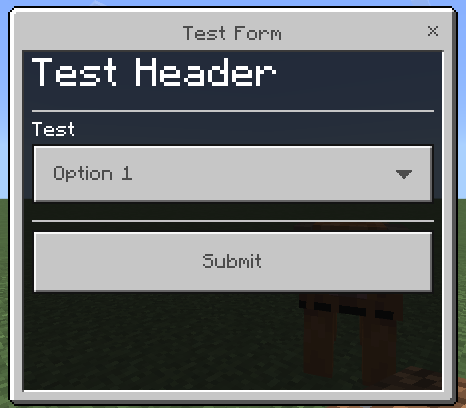

## Example: Effect Generator Form


### Example Code (v2)

```js
import { Player, world } from "@minecraft/server";
import { ModalFormData } from "@minecraft/server-ui";
let form = new ModalFormData();
let effectList = [
  { name: "Regeneration", id: "minecraft:regeneration" },
  { name: "Resistance", id: "minecraft:resistance" },
  { name: "Fire Resistance", id: "minecraft:fire_resistance" },
  { name: "Poison", id: "minecraft:poison" },
];
form.title("Effect Generator");
form.textField("Target", "Target of Effect");
form.dropdown(
  "Effect Type",
  effectList.map((effect) => effect.name)
);
form.slider("Effect Level", 0, 255, {
  defaultValue: 1,
  tooltip: "Level of the effect",
  valueStep: 1,
});
form.toggle("Hide Effect Particle", {
  defaultValue: true,
  tooltip: "Toggle to hide/show effect particles",
});
for (const player of world.getAllPlayers()) {
  form.show(player).then((response) => {
    if (response.canceled) {
      player.sendMessage("Canceled due to " + response.cancelationReason);
    } else {
      const [targetName, dropdownValue, effectLevel, hideParticles] =
        response.formValues;
      if (
        typeof dropdownValue !== "string" ||
        typeof dropdownValue !== "number" ||
        typeof effectLevel !== "number" ||
        typeof hideParticles !== "boolean"
      )
        return player.sendMessage("Cannot process form result.");
      const target = world
        .getAllPlayers()
        .find((player) => player.name === targetName);
      if (!(target instanceof Player))
        return player.sendMessage("Target does not exist.");
      target.addEffect(effectList[dropdownValue].id, 50, {
        amplifier: effectLevel,
        showParticles: !hideParticles,
      });
    }
  });
}
```

### Example Code (v1)

```js
import { Player, world } from "@minecraft/server";
import { ModalFormData } from "@minecraft/server-ui";
let form = new ModalFormData();
let effectList = [
  { name: "Regeneration", id: "minecraft:regeneration" },
  { name: "Resistance", id: "minecraft:resistance" },
  { name: "Fire Resistance", id: "minecraft:fire_resistance" },
  { name: "Poison", id: "minecraft:poison" },
];
form.title("Effect Generator");
form.textField("Target", "Target of Effect");
form.dropdown(
  "Effect Type",
  effectList.map((effect) => effect.name)
);
form.slider("Effect Level", 0, 255, 1);
form.toggle("Hide Effect Particle", true);
for (const player of world.getAllPlayers()) {
  form.show(player).then((response) => {
    if (response.canceled) {
      player.sendMessage("Canceled due to " + response.cancelationReason);
    } else {
      const [targetName, dropdownValue, effectLevel, hideParticles] =
        response.formValues;
      if (
        typeof dropdownValue !== "string" ||
        typeof dropdownValue !== "number" ||
        typeof effectLevel !== "number" ||
        typeof hideParticles !== "boolean"
      )
        return player.sendMessage("Cannot process form result.");
      const target = world
        .getAllPlayers()
        .find((player) => player.name === targetName);
      if (!(target instanceof Player))
        return player.sendMessage("Target does not exist.");
      target.addEffect(effectList[dropdownValue].id, 50, {
        amplifier: effectLevel,
        showParticles: !hideParticles,
      });
    }
  });
}
```

**Modal Form v2.0.0-beta features**

@minecraft/server-ui v2.0.0-beta module currently adds [headers](https://jaylydev.github.io/scriptapi-docs/preview/classes/_minecraft_server-ui.ModalFormData-1.html#header), [dividers](https://jaylydev.github.io/scriptapi-docs/preview/classes/_minecraft_server-ui.ModalFormData-1.html#divider), [labels](https://jaylydev.github.io/scriptapi-docs/preview/classes/_minecraft_server-ui.ModalFormData-1.html#label) and more. The following images demostrates those features (subject to change).



> Image from [xKingDark](https://github.com/DarkGamerYT)
